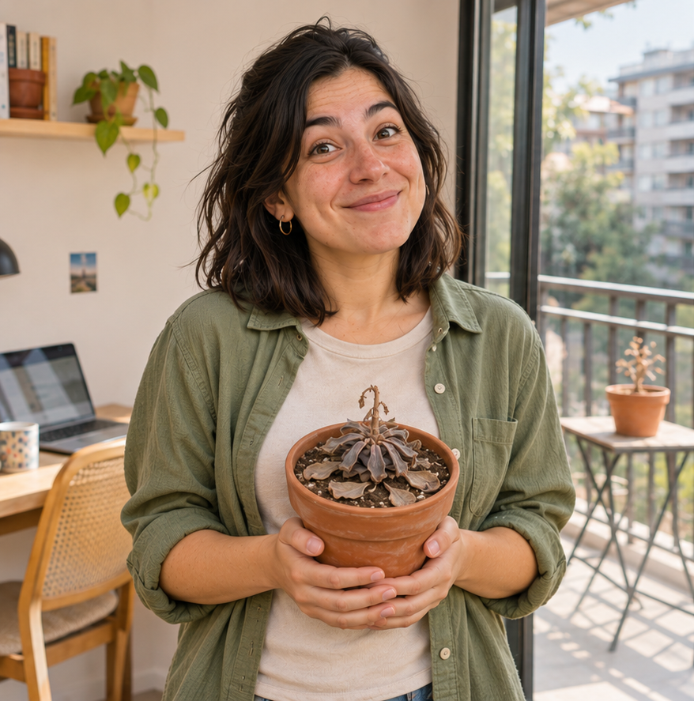
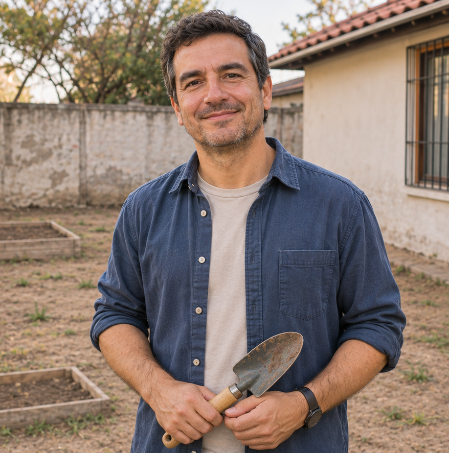

# Proto-persona — Brote

> Guía: [Proto-persona](../evaluacion/guias/fase-1-requerimientos/02-proto-persona.md)

## Proto-persona principal

**Camila Rojas, 29 años.** Diseñadora gráfica, trabaja en una oficina en Viña del Mar y vive en un departamento con balcón en Quilpué.

> "Compro plantas preciosas y a los dos meses se me mueren."

### Comportamientos

- Sigue cuentas de decoración y plantas en Instagram y TikTok; guarda publicaciones de departamentos llenos de plantas.
- Compra online desde el celular, de noche, después de las 21:00.
- Cuando una planta se ve mal, busca en Google qué le pasa ("hojas amarillas monstera").
- Compra de a 2 o 3 productos para que le convenga el despacho.

### Necesidades

- Que la guíen en el cuidado de cada planta: cuánto regar, cuánta luz, cuándo abonar.
- Saber qué sustrato, fertilizante o producto necesita cada tipo de planta.
- Conocer el costo de despacho antes de llegar al pago.

### Motivaciones

- Tener una casa bonita, llena de plantas.
- Sentir que es capaz de cuidar algo vivo.
- Crear un rincón tranquilo en su departamento para desconectarse.

### Frustraciones

- Que se le mueran las plantas sin saber por qué.
- Productos con nombres técnicos ("fitosanitario", "NPK") que no sabe para qué sirven.
- Descubrir un despacho caro recién al final de la compra.

## Segunda proto-persona (opcional)

**Jorge Muñoz, 42 años.** Vive en su casa propia con patio en Villa Alemana, y quiere empezar a jardinear. El clima del interior le mata todas las plantas.

> "Quiero un patio verde, pero acá todo se me seca."

### Comportamientos

- Está partiendo: compra de a poco, probando qué le resiste.
- Usa el computador para comprar y el celular para WhatsApp.
- Prefiere preguntar antes de comprar algo que no conoce.

### Necesidades

- Saber qué plantas y productos aguantan el clima del interior (calor y sequedad en verano, frío en invierno).
- Entender cómo cuidar su patio, con instrucciones simples.
- Comprar formatos grandes para cubrir el patio.

### Motivaciones

- Tener un patio verde en su casa propia.
- Lograr, por fin, que una planta le dure.

### Frustraciones

- Que las plantas se le mueran por el clima, sin saber qué hizo mal.
- No saber qué sirve para su zona.
- No poder preguntar a una persona antes de comprar.

> Cuando las necesidades de Camila y Jorge entren en conflicto, gana Camila, que es la proto-persona principal.
