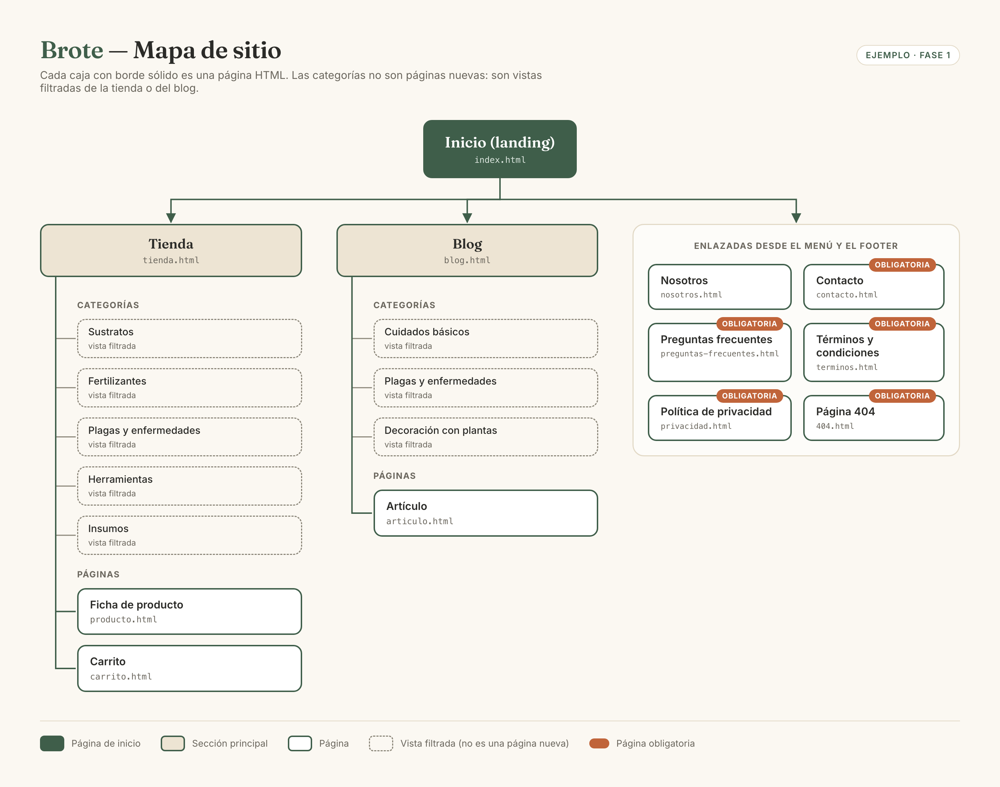
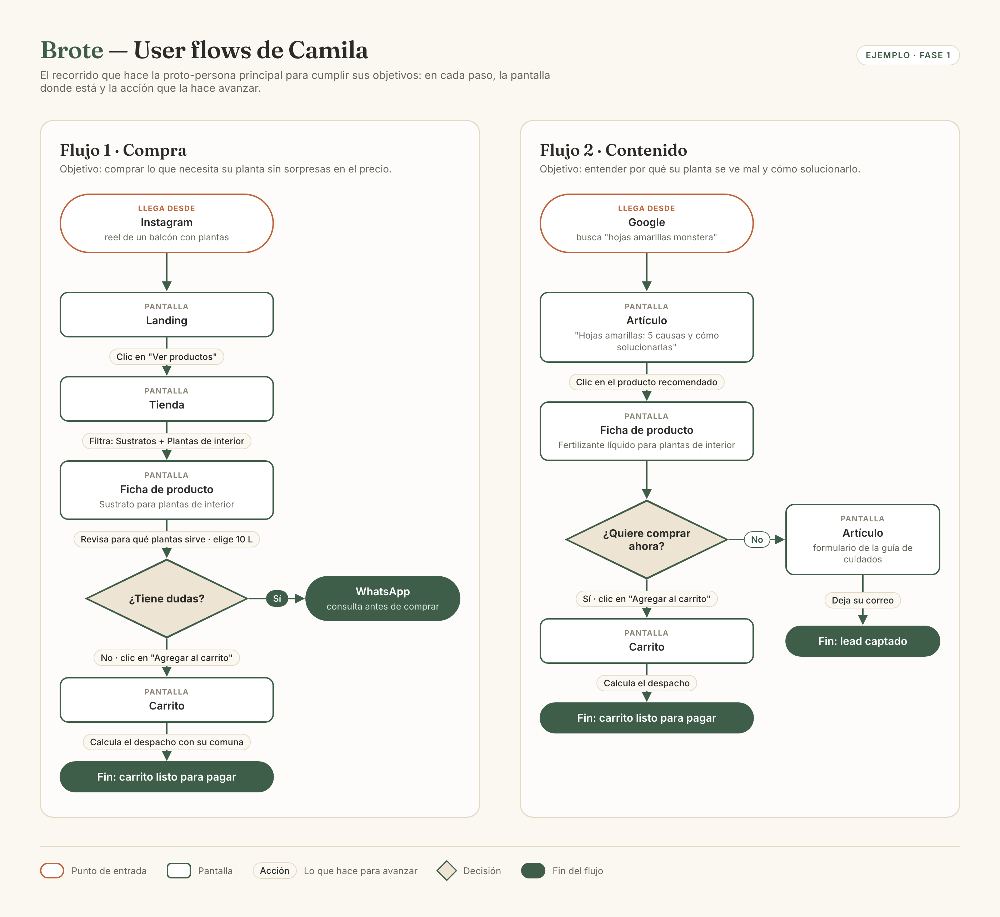

# Arquitectura de la información — Brote

> Guía: [Arquitectura de la información](../evaluacion/guias/fase-1-requerimientos/05-arquitectura.md)

## Mapa de sitio

```text
Inicio (landing)
├── Tienda
│   ├── Categoría: Suculentas
│   ├── Categoría: Cactus
│   ├── Categoría: Maceteros
│   ├── Categoría: Sustratos
│   ├── Categoría: Fertilizantes
│   ├── Categoría: Herramientas
│   ├── Ficha de producto
│   ├── Carrito
│   ├── Finalizar compra (pago con Mercado Pago)
│   └── Mi cuenta
├── Blog
│   ├── Categoría: Cuidados básicos
│   ├── Categoría: Plagas y enfermedades
│   ├── Categoría: Decoración con plantas
│   └── Artículo
├── Guías (3 guías gratis en PDF)
├── Nosotros
├── Contacto
├── Preguntas frecuentes
├── Términos y condiciones
├── Política de privacidad
└── 404
```

El menú tiene **Inicio, Nosotros, Blog, Guías y Tienda**; Contacto, Preguntas frecuentes, Términos y Política de privacidad están en el footer. Las categorías no son páginas nuevas: son la misma página de tienda o de blog, filtrada. En WordPress, Finalizar compra y Mi cuenta las crea WooCommerce.



### Dónde ocurre cada funcionalidad

| Funcionalidad | Página |
|---|---|
| Guías gratuitas en PDF a cambio del correo | Guías |
| Suscripción al newsletter | Inicio, Blog y Artículo |
| Producto recomendado y destacados del mes | Inicio |
| Buscar productos | Menú (todas las páginas) y Tienda |
| Explorar por categoría, filtrar y ordenar productos | Tienda |
| Ver detalle, cómo usarlo, elegir cantidad y agregar al carrito | Ficha de producto |
| Kits (sustrato, fertilizante y macetero) | Tienda y Ficha de producto |
| Elegir retiro en tienda o despacho y ver el total | Carrito |
| Pagar con Mercado Pago | Finalizar compra |
| Crear cuenta y entrar a Mi cuenta | Menú |
| Navegar por categorías, comentar y compartir | Blog y Artículo |
| Producto recomendado dentro de un artículo | Artículo |
| Escribir por WhatsApp o por el formulario con asunto | Contacto |
| Buscar en las preguntas frecuentes | Preguntas frecuentes |

## User flows

> Guía: [User flow](../evaluacion/guias/fase-1-requerimientos/06-user-flow.md)

### Flujo 1: compra (Camila)

```text
Instagram (reel de un balcón con plantas)
→ Landing
→ [Clic en "Comprar plantitas"]
→ Tienda
→ [Filtra por "Suculentas" y tipo "Interior"]
→ Ficha de producto: Echeveria elegans en maceta
→ [Lee "Cuidados y uso" y elige la cantidad]
◇ ¿Tiene dudas?
   ├── Sí → [Clic en "Escribir por WhatsApp" en Contacto] → WhatsApp
   └── No → [Clic en "Agregar al carrito"]
→ Carrito
→ [Elige retiro en tienda (gratis) o despacho a domicilio ($3.490)]
→ [Clic en "Ir a pagar"]
→ Fin: pago con Mercado Pago
```

### Flujo 2: contenido (Camila)

```text
Google ("hojas amarillas monstera")
→ Artículo: "Hojas amarillas: 5 causas y cómo solucionarlas"
→ [Lee y hace clic en el producto recomendado]
→ Ficha de producto: Fertilizante líquido para plantas de interior 500 ml
◇ ¿Quiere comprar ahora?
   ├── Sí → [Agregar al carrito] → Carrito
   └── No → [Vuelve al artículo y deja su correo para recibir la guía de cuidados]
          → Fin: lead captado
```

### Flujo 3: elegir para su patio (Jorge)

```text
Google ("plantas que resisten el calor patio")
→ Tienda
→ [Filtra por tipo "Exterior"]
→ Ficha de producto: Aeonium arboreum en maceta
◇ ¿Le sirve para su clima?
   ├── Sí → [Agregar al carrito] → Carrito → Fin: retiro en tienda o despacho
   └── No → [Escribe por el formulario de Contacto con el asunto "Una duda sobre un producto"]
          → Fin: consulta enviada
```

### Diagrama de los flujos



## Categorías

> Guía: [Categorías de productos y temas del blog](../evaluacion/guias/fase-1-requerimientos/07-categorias.md)

### Categorías de productos

| Categoría | Productos |
|---|---|
| Suculentas | 12 suculentas en maceta (Echeveria, Aeonium, Graptopetalum y Sedum) y el kit suculentas |
| Cactus | Cactus de barril en maceta blanca |
| Maceteros | Set de 3 maceteros de cerámica y el kit plantas de interior |
| Sustratos | Sustrato para plantas de interior, tierra de hoja, sustrato para suculentas y cactus, perlita, sustrato para huerto y los kits |
| Fertilizantes | Humus de lombriz, fertilizante líquido para plantas de interior, aceite de neem y los kits |
| Herramientas | Set de herramientas de jardinería y el kit huerto |

Cada kit aparece en las categorías de lo que contiene. "Plagas y enfermedades" no es una categoría de la tienda: es un tema del blog, porque Camila busca por el problema que tiene y no por el tipo de producto.

Filtros adicionales de la tienda: **tipo de planta** (interior, exterior, suculentas y cactus, huerto) y **precio máximo**. Orden: recomendado, más vendidos, menor precio, mayor precio, nombre y nuevo.

### Categorías del blog

| Categoría | Idea de artículo | Necesidad o motivación de la proto-persona | Producto relacionado |
|---|---|---|---|
| Cuidados básicos | "Cuánto regar tus plantas de interior (y por qué se te mueren)" | A Camila le frustra que se le mueran las plantas | Sustrato para plantas de interior, regadera |
| Plagas y enfermedades | "Hojas amarillas: 5 causas y cómo solucionarlas" | Camila necesita que la guíen cuando una planta se ve mal | Fertilizante líquido, aceite de neem |
| Decoración con plantas | "5 plantas fáciles para un departamento con poca luz" | Camila quiere una casa bonita con plantas | Set de 3 maceteros de cerámica, kit de plantas de interior |
