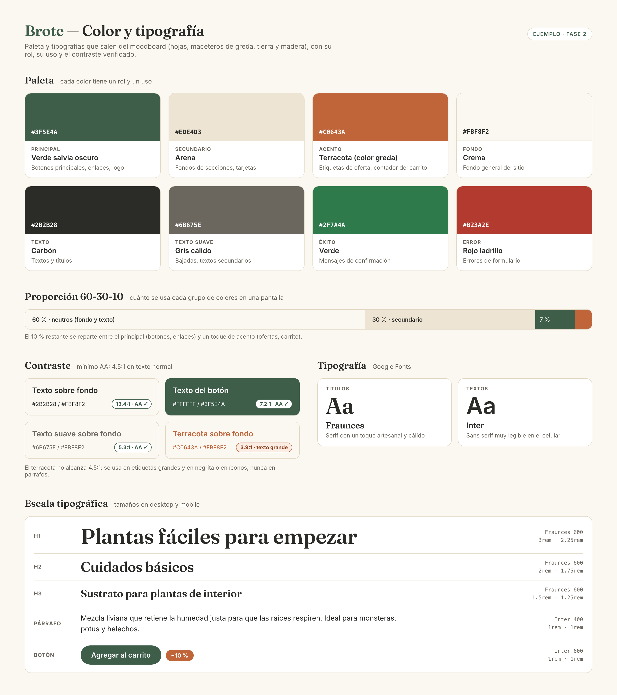

# Color y tipografía — Brote

> Guía: [Color y tipografía](../evaluacion/guias/fase-2-specs/05-color-y-tipografia.md)

## Paleta

| Rol | Color | HEX | Uso |
|---|---|---|---|
| Principal | Verde bosque | #305941 | Títulos, enlaces, logo, íconos |
| Acento (acción) | Fucsia | #A93B6A | Botones principales, nombre científico, enlaces de guía |
| Secundario | Verde lima suave | #E6ECB7 | Bandas de sección, caja de guía, newsletter, botón "Mi cuenta" |
| Secundario suave | Lima grisáceo | #E7E9CD | Fondo de la banda "Destacados del mes" |
| Rosa pálido | Rosa | #F8E8F0 | Círculos de categorías y del hero |
| Menta pálido | Menta | #E8F3EC | Círculos de categorías, hover de botones secundarios |
| Decorativo | Verde medio | #4C8D62 | Solo ilustraciones e íconos grandes |
| Decorativo | Verde oliva | #ACB84A | Líneas onduladas y franja superior |
| Footer | Verde bosque claro | #3A5745 | Fondo del footer |
| Fondo | Blanco cálido | #FEFDF9 | Fondo general |
| Texto | Verde casi negro | #202924 | Textos |
| Texto suave | Gris verdoso | #5E6B63 | Bajadas, textos secundarios |
| Éxito | Verde | #2F7A4A | Mensajes de confirmación |
| Error | Rojo ladrillo | #B23A2E | Errores de formulario |

Proporción de uso: 60 % neutro y blanco, 25 % lima y rosa pálido (bandas y círculos), 15 % verde bosque y fucsia.

## Contraste

Calculado con la fórmula de WebAIM.

| Combinación | Ratio | Resultado |
|---|---|---|
| Texto #202924 sobre fondo #FEFDF9 | 14.7:1 | AA ✅ |
| Texto #202924 sobre lima grisáceo #E7E9CD | 12.1:1 | AA ✅ |
| Verde bosque #305941 sobre fondo #FEFDF9 | 7.8:1 | AA ✅ |
| Verde bosque #305941 sobre lima #E6ECB7 | 6.5:1 | AA ✅ |
| Texto blanco sobre verde bosque #305941 | 8.0:1 | AA ✅ |
| Texto suave #5E6B63 sobre fondo #FEFDF9 | 5.5:1 | AA ✅ |
| Fucsia #A93B6A sobre fondo #FEFDF9 | 5.9:1 | AA ✅ |
| Texto blanco sobre fucsia #A93B6A | 6.0:1 | AA ✅ |
| Fucsia #A93B6A sobre lima #E6ECB7 | 4.8:1 | AA ✅ |
| Verde medio #4C8D62 sobre fondo #FEFDF9 | 3.9:1 | Solo decoración ⚠️ |
| Texto blanco sobre verde medio #4C8D62 | 4.0:1 | No alcanza AA ❌ |

El verde medio y el oliva no alcanzan 4.5:1, así que nunca se usan para texto ni como fondo de texto blanco: son solo decoración.

## Tipografía

- **Títulos:** Bree Serif (serif redondeada y amable, la del logo).
- **Textos:** Inter (sans serif muy legible en pantallas pequeñas).

| Elemento | Desktop | Mobile | Peso |
|---|---|---|---|
| h1 | 3rem | 2.25rem | 400 |
| h2 | 2rem | 1.75rem | 400 |
| h3 | 1.5rem | 1.25rem | 400 |
| Párrafo | 1rem | 1rem | 400 |
| Botón | 1rem | 1rem | 600 |

## Justificación

El verde bosque viene de las hojas y el fucsia de las flores de las suculentas; el lima y el rosa pálido dan frescura y un aire juguetón. El fondo blanco cálido deja respirar las fotos. Bree Serif le da calidez y personalidad a los títulos, e Inter asegura que Camila pueda leer las guías de cuidado sin esfuerzo en su celular.
