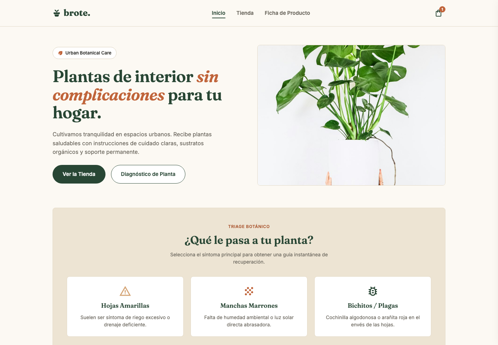
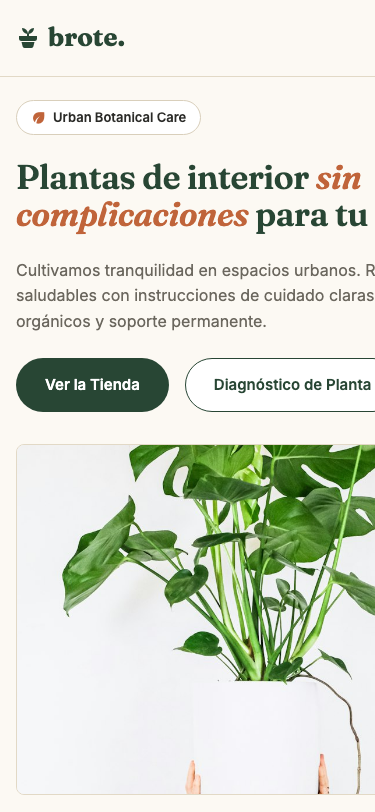
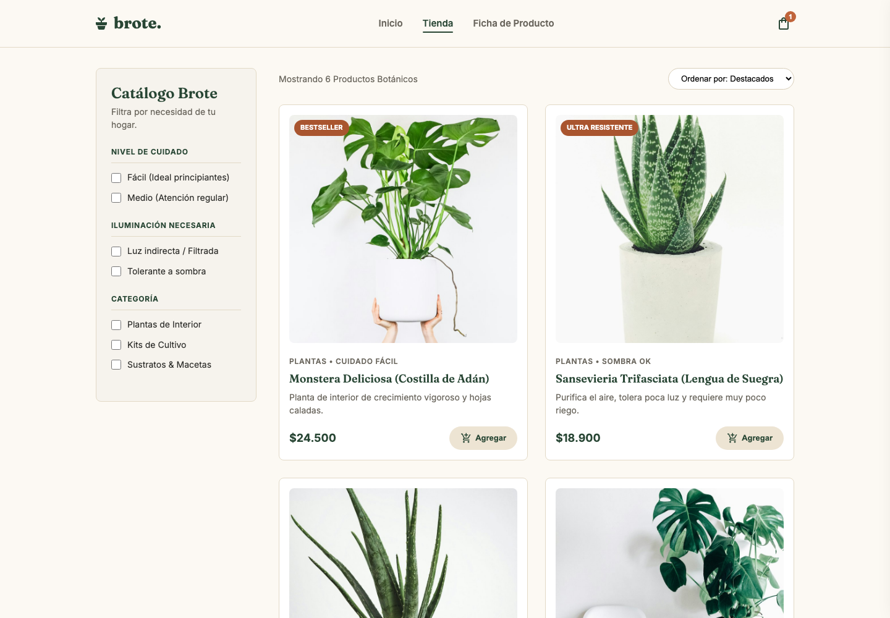
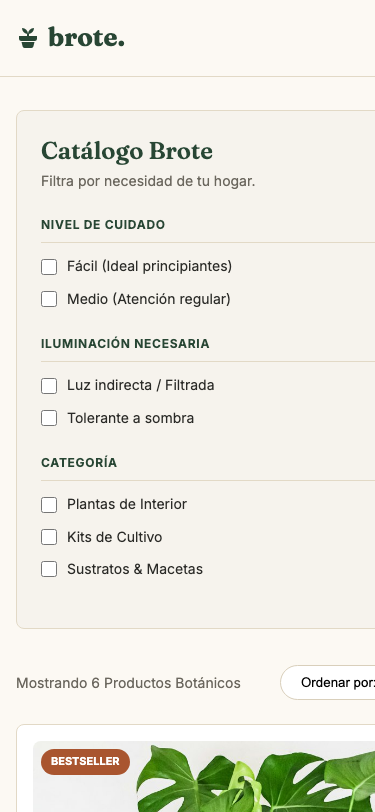
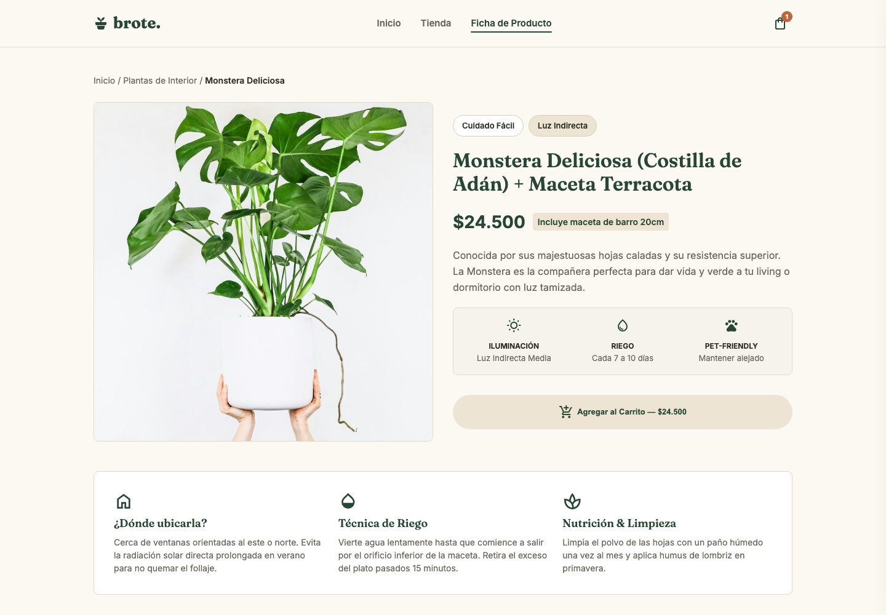
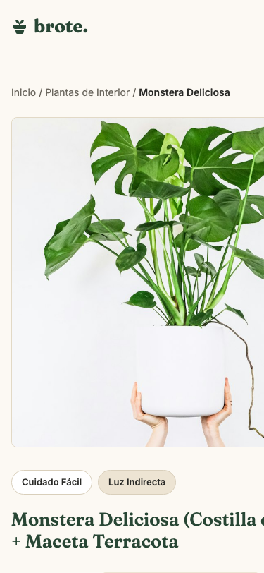
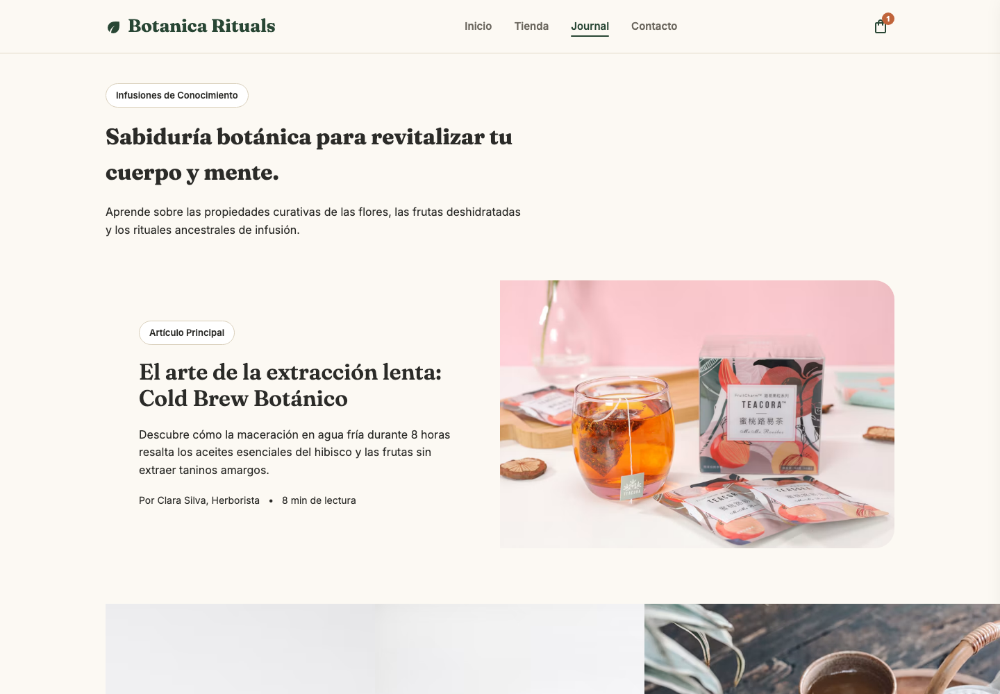
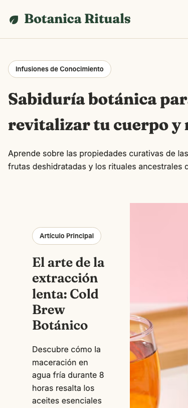

# QA — Brote

> Guía: [QA y coherencia](../evaluacion/guias/fase-3-prototipo/02-qa-y-coherencia.md)

## Prototipo en Stitch

**Proyecto:** [pendiente: pegar aquí el link del proyecto de Stitch, abierto para cualquiera con el enlace]

Generé las pantallas con el `DESIGN.md` importado y los prompts de [`09-spec-diseno.md`](09-spec-diseno.md). Después exporté el código de cada pantalla para revisarlas en el navegador (en desktop a 1440 px y en mobile a 375 px).

| Pantalla | Desktop | Mobile |
|---|---|---|
| Landing |  |  |
| Tienda |  |  |
| Ficha de producto |  |  |
| Blog |  |  |
| Carrito | No generada (ver QA) | No generada (ver QA) |
| Artículo | No generado (ver QA) | No generado (ver QA) |

## Revisión: spec vs. prototipo

Resultado: ✅ se cumplió a la primera · ❌ → ✅ no se cumplía y lo corregí · ❌ no se cumple (explico por qué).

| Pantalla | Qué dice la spec | Qué generó Stitch | Resultado | Corrección |
|---|---|---|---|---|
| Landing | h1 "Plantas sanas, casa bonita" y botones "Ver productos" y "Leer guías" | h1 "Plantas de interior sin complicaciones para tu hogar" y botones "Ver la Tienda" y "Diagnóstico de Planta" | ❌ | Reescribo el prompt con los textos exactos entre comillas y le pido que no los reformule |
| Landing | Sección "Plantas fáciles para empezar" con 3 cards (Potus, Monstera, Suculentas) | "Kits de Cultivo & Plantas de Casa" con Monstera, un kit y Ficus | ❌ | Nombro las 3 plantas en el prompt y agrego "no incluyas otros productos" |
| Landing | `box-lead-form` con campo de correo, "Quiero la guía" y texto de privacidad | No generó el formulario de leads | ❌ | Pido el `box-lead-form` por nombre del `DESIGN.md`. Sin el formulario Camila no deja su correo, y es la funcionalidad base de la landing |
| Landing | Sección "Del blog" con 3 `card-article` | No generó la sección | ❌ | La agrego al prompt, después de la guía de uso |
| Landing | La caja "¿Qué le pasa a tu planta?" va en el blog | Stitch la puso en la landing (hojas amarillas, manchas, plagas) | ✅ | Me sirve: la dejo en la landing y la quito del blog en la spec, porque ahí lleva más rápido al diagnóstico |
| Landing, tienda y ficha | Navbar con Tienda, Blog, Nosotros y Contacto | Navbar con Inicio, Tienda y "Ficha de Producto" | ❌ → ✅ | "Ficha de Producto" no es una página del mapa de sitio. En `DESIGN.md` agrego a la regla de `navbar`: "enlaces fijos: Tienda, Blog, Nosotros, Contacto" |
| Landing y tienda | Colores y tipografías de los tokens | Verde oscuro, crema y terracota; títulos en serif | ✅ | — |
| Tienda | Buscador "Buscar productos o plantas…" | No hay buscador | ❌ | Lo agrego al prompt. La búsqueda es funcionalidad base de la tienda |
| Tienda | Chips de categoría (Sustratos, Fertilizantes, Plagas…) | Las categorías son casillas en la columna de filtros | ❌ | Pido chips arriba de la grilla |
| Tienda | Fila de 3 `card-kit` antes de la grilla | No generó los kits | ❌ | Agrego `card-kit` al prompt con los 3 kits y sus ahorros |
| Tienda | Filtros "Tipo de planta" y rango de precio | Filtros "Nivel de cuidado", "Iluminación" y "Categoría"; sin precio | ❌ | Pido los filtros exactos de la spec. "Nivel de cuidado" lo dejo anotado como idea para la etapa 2 |
| Tienda | 6 productos de sustratos (Sustrato interior $7.990, Tierra de hoja, Perlita…) | 6 productos, pero son plantas, kits y macetas (Monstera $24.500, Sansevieria…) | ❌ | Copio la lista de productos con nombre y precio en el prompt |
| Tienda | Precio visible en todas las `card-product` | Todas muestran precio y botón "Agregar" | ✅ | — |
| Tienda (mobile) | Filtros detrás del botón "Filtrar" | La columna de filtros ocupa toda la pantalla y el contenido se corta por el lado derecho | ❌ | Pido: "en mobile los filtros se abren desde un botón Filtrar; sin scroll horizontal" |
| Ficha | Producto "Sustrato para plantas de interior" con formatos 5 L, 10 L y 20 L | Producto "Monstera Deliciosa + Maceta Terracota" sin selector de formato | ❌ | Pido el producto de la spec y los chips de formato |
| Ficha | Botón secundario "Consultar por WhatsApp" | Solo "Agregar al Carrito" | ❌ | Lo agrego al prompt: es una funcionalidad propia imprescindible |
| Ficha | `box-usage-guide` con tres columnas: para qué plantas, cómo usarlo, cada cuánto | Tres bloques: dónde ubicarla, técnica de riego, nutrición | ✅ | Cambia el contenido, pero la idea es la misma. Ajusto el texto del prompt |
| Ficha | "Productos relacionados" con 3 `card-product` | No hay sección | ❌ | La agrego al prompt |
| Blog | Blog de Brote con 4 artículos (hojas amarillas, riego, poca luz, trasplante) | Un blog de otra marca ("Botanica Rituals"), con infusiones y mocktails | ❌ | Regenero la pantalla indicando "Brote" y los 4 artículos con sus títulos. Parece que mezclé este prompt con otro proyecto de Stitch |
| Carrito | `box-cart-summary` con subtotal, comuna, despacho y total | No hay página. Solo un panel lateral "Tu Carrito Brote" con el total | ❌ | Genero la pantalla aparte con el prompt de la spec. El panel no calcula despacho por comuna |
| Artículo | Texto, producto recomendado, compartir, comentarios y `box-lead-form` | No hay pantalla | ❌ | Genero la pantalla. Sin ella el flujo de contenido no llega a ningún producto |

## Mejoras a mis specs

- En los prompts de `09-spec-diseno.md`, los textos y nombres de producto van **entre comillas y con la instrucción "no reformules"**. Stitch cambió títulos y botones cuando solo los describí.
- En `09-spec-diseno.md`, los componentes se nombran como en el `DESIGN.md` (`box-lead-form`, `card-kit`, `box-usage-guide`) en vez de describirlos. Cuando los describí, Stitch no los generó.
- En `DESIGN.md`, la regla de `navbar` ahora dice cuáles son los 4 enlaces fijos.
- En `DESIGN.md`, en la sección Layout, agrego para mobile: "los filtros siempre van detrás de un botón; nunca ocupan la pantalla" y "sin scroll horizontal".
- En cada prompt agrego una línea final: "No agregues secciones ni productos que no estén en esta lista".

## User flows

| Flujo | Recorrido en el prototipo | ¿Se completa? |
|---|---|---|
| Compra | Landing → [Ver la Tienda] → Tienda → [Agregar] → panel del carrito → [Finalizar Pedido] | ❌ Se llega a la tienda y se agrega un producto, pero no existe la pantalla Carrito y la ficha se alcanza solo desde el navbar, no desde la card |
| Contenido | Landing → [Hojas amarillas] → guía instantánea → producto recomendado | ❌ No es el flujo de la Fase 1: no hay blog de Brote ni artículo, así que no se puede ir de un artículo a una ficha |

Los dos flujos quedan pendientes de volver a recorrer cuando estén las 6 pantallas.

## Coherencia

El brief define como objetivo vender online a quienes recién empiezan con plantas, y la landing ya apunta a eso: el hero promete plantas sin complicaciones y la caja "¿Qué le pasa a tu planta?" ayuda a Camila a diagnosticar. Su frustración principal es que se le mueren las plantas sin saber por qué, y eso lo resuelven la guía de uso y la ficha con riego e iluminación. Hoy eso funciona en tres pantallas.

Lo que no funciona todavía es lo que necesita para comprar con confianza: no hay carrito con despacho por comuna, que era su temor a un costo sorpresa, ni formulario de leads, ni artículo que lleve del blog a un producto. Tampoco está el buscador ni los filtros por tipo de planta, que eran su camino rápido hacia lo que sirve para su planta.

Cambió también el catálogo: Stitch inventó plantas y macetas, y mi spec era de sustratos y fertilizantes. Prefiero volver a mi spec, porque esos productos responden a "mantener sanas las plantas que ya tengo", que es lo que dice mi proto-persona. Lo de vender plantas lo anoto para una etapa posterior.
