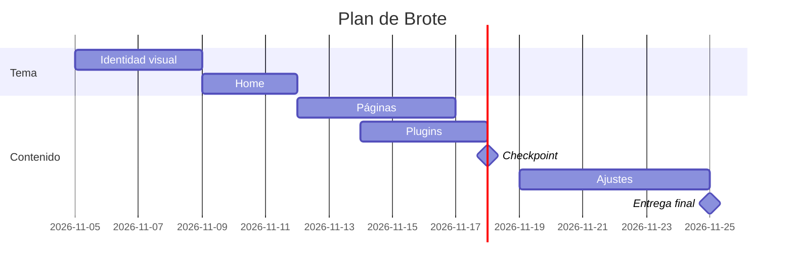

# Decisiones de mi sitio

**Emprendimiento:** Brote · **Fecha:** 13 de noviembre · **Última corrección:** (fecha)

## 1. Plugins (10 pts)

Cinco plugins, cada uno resuelve una funcionalidad de `docs/03-funcionalidades.md`. Los cuatro primeros son los del curso; el quinto cubre la captación de correos, que es el objetivo secundario del sitio. Guía: `guia-investigar-plugins.md`.

| # | Funcionalidad | Plugin | Gratis o de pago | Qué incluye la versión gratis | Probado hasta (WP) | Requiere PHP | ¿Funciona con tema propio? | Enlace a la ficha |
|---|---|---|---|---|---|---|---|---|
| 1 | SEO (obligatorio): que Camila encuentre los artículos al buscar "hojas amarillas monstera" | Yoast SEO | Gratis (con versión premium) | Título y descripción por página, sitemap XML, migas de pan, análisis de palabra clave y legibilidad | 7.1.4 | 7.4 | Sí: el tema solo debe llamar a `wp_head()` | [wordpress.org/plugins/wordpress-seo](https://wordpress.org/plugins/wordpress-seo/) |
| 2 | Contacto (obligatorio): formulario de la página Contacto con asunto | Contact Form 7 | Gratis | Formularios ilimitados, campos y avisos por correo, shortcode `[contact-form-7]` que se pega en la plantilla | 7.1.4 | 8.3 | Sí: el formulario se inserta con shortcode y se estiliza con el CSS del tema | [wordpress.org/plugins/contact-form-7](https://wordpress.org/plugins/contact-form-7/) |
| 3 | Comentar artículos sin llenarse de spam (blog, "Deseable") | Akismet | Gratis para uso personal | Filtro antispam de comentarios y de los envíos de Contact Form 7, con panel de spam | 7.1.4 | 7.2 | Sí: funciona sobre los comentarios de WordPress, sin tocar el tema | [wordpress.org/plugins/akismet](https://wordpress.org/plugins/akismet/) |
| 4 | Respaldo y migración del sitio (para reinstalar en otro servidor) | BackWPup | Gratis (con versión pro) | Respaldo de archivos y base de datos en `.zip`, descarga manual y programación | 7.1.4 | 7.4 | Sí: respalda el tema propio junto con todo el sitio | [wordpress.org/plugins/backwpup](https://wordpress.org/plugins/backwpup/) |
| 5 | Dejar el correo a cambio de la guía de cuidados y el 10 % (imprescindible) | Mailchimp for WP | Gratis (con versión premium) | Formulario de suscripción por shortcode, conexión con una cuenta gratuita de Mailchimp y casilla de consentimiento | 7.1.4 | 7.4 | Sí: el formulario se inserta con shortcode en Inicio y en el artículo | [wordpress.org/plugins/mailchimp-for-wp](https://wordpress.org/plugins/mailchimp-for-wp/) |

Datos de "Probado hasta" y "Requiere PHP" tomados de la ficha de cada plugin en WordPress.org.

**Plugins que descarté por ahora:** WooCommerce (buscador, filtros, carrito, kits y despacho van al plan de continuidad) y Click to Chat (el botón de WhatsApp ya funciona como enlace `wa.me` en el tema).

## 2. Páginas de la fase 1 (5 pts)

| # | Página | Por qué la elijo (una línea) |
|---|---|---|
| 1 | Inicio (obligatoria) | Es la puerta de entrada desde Instagram y donde se capta el correo a cambio de la guía. |
| 2 | Contacto (obligatoria) | Permite escribir a Brote antes de comprar, con el formulario de Contact Form 7. |
| 3 | Blog | Los artículos por categoría traen a Camila desde Google y enseñan a cuidar sus plantas. |
| 4 | Nosotros | Cuenta quién está detrás del local de barrio y da confianza para comprar online. |
| 5 | Preguntas frecuentes | Responde las dudas que hoy llegan por mensaje directo (despacho, formatos, retiro). |

**Páginas que dejo para después:** Tienda, Ficha de producto y Carrito (necesitan WooCommerce), Términos y condiciones, Política de privacidad y 404.

## 3. Plan del tema (5 pts)

- **Nombre del tema:** brote
- **Custom o descargado:** custom, porque el diseño ya está hecho en HTML y CSS (`DESIGN.md`) y se traspasa a PHP sin adaptar un tema ajeno.
- **Carta Gantt** del desarrollo del sitio (5 al 25 de noviembre):

| Etapa | Desde | Hasta | Notas |
|---|---|---|---|
| Identidad visual | 5 nov | 8 nov | Pasar `styles.css`, colores y tipografías a `style.css` y `functions.php` |
| Home | 9 nov | 11 nov | `front-page.php`, `header.php` y `footer.php` |
| Páginas | 12 nov | 16 nov | Contacto, Nosotros y Preguntas frecuentes; blog con `index.php` y `single.php` |
| Plugins | 14 nov | 17 nov | Yoast, Contact Form 7, Akismet, Mailchimp for WP y BackWPup |
| **Checkpoint (18 nov)** | | 18 nov | Revisar con el docente y corregir si hace falta |
| Ajustes y formulario | 19 nov | 24 nov | Formulario de contacto con asunto, Lighthouse y README de respaldo |
| **Entrega final (25 nov)** | | 25 nov | Sitio en producción y plan de continuidad |

## 4. Plan B (5 pts)

| Riesgo | Qué hago | Cuándo se activa (fecha o señal) |
|---|---|---|
| El tema propio no funciona o se rompe | Vuelvo al último commit que funcionaba y subo ese `.zip`; si no alcanza, uso `tema-base/` con los estilos de Brote encima. | Pantalla blanca al activar el tema, o si el 16 nov Inicio no se ve bien en WordPress |
| Un plugin falla o no es compatible | Lo desactivo, pruebo la versión anterior desde WordPress.org y, si sigue fallando, lo reemplazo (Mailchimp for WP por un formulario de Contact Form 7). | Error al activarlo, formulario que no envía o aviso de PHP |
| InfinityFree se cae o limita el sitio | Guardo un respaldo con BackWPup cada vez que cierro una etapa para reinstalar el sitio en otro hosting gratuito. | Sitio caído más de un día o cuenta suspendida, antes del 25 nov |
| No alcanzo a terminar todas las páginas | Entrego las 5 de la fase 1 y paso el resto (Tienda, Carrito, legales) al plan de continuidad. | Al llegar al checkpoint del 18 nov con menos de 3 páginas listas |
